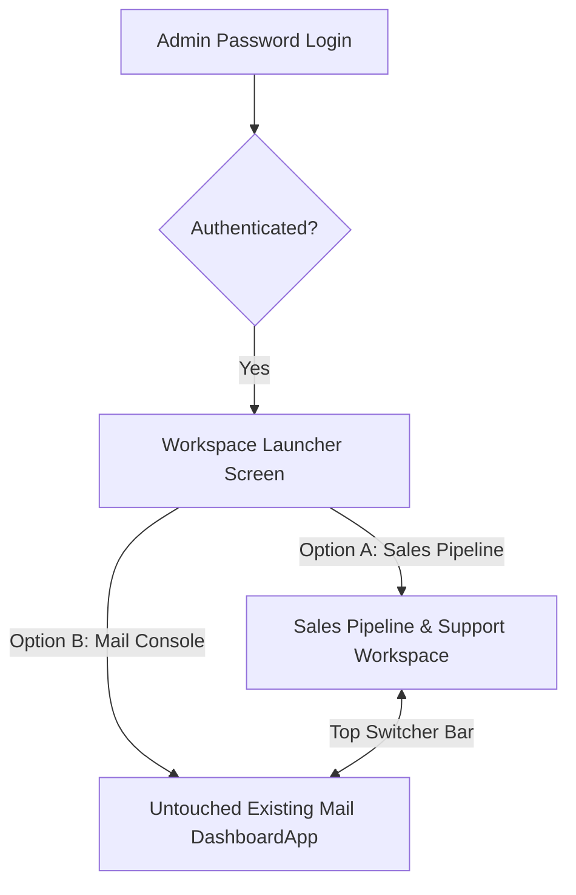

# Implementation Plan: Dual-Workspace Platform (Sales Pipeline & Support + Mail Console)

## 1. Executive Summary & Core Objective

The objective is to expand the current SupermailBox platform into a **Dual-Workspace Platform** without altering or breaking any existing email infrastructure:

1. **Workspace 1: 🎯 Sales Pipeline & Support (New Module)**
   - Tracks GetAiPilot user onboarding & lifecycle funnel.
   - Monitors drop-offs (who stopped at onboarding, which step they dropped).
   - Categorizes leads: `New Signup`, `Onboarding Dropped`, `Onboarded`, `Might Be Converted`, `Converted`, `Not Interested`.
   - Provides a 1-click sales support drawer (notes, status changes, direct WhatsApp/email triggers).

2. **Workspace 2: ✉️ Mail Operations & Campaigns (Existing System - 100% Untouched)**
   - The current `DashboardApp` (Email Builder, Templates, Campaigns, Delivery Logs, Suppressions, Brand Library).
   - Zero changes to mail generation, sending queues, or templates.

---

## 2. Strict Non-Negotiable Constraint

> [!IMPORTANT]
> **Existing Mail System Protection Protocol**
> - **Zero modifications** to existing mail routes (`/v1/email/*`, `/v1/templates/*`, `/v1/webhooks/*`).
> - **Zero modifications** to existing mail UI components (`SegmentBuilder`, `TemplateBuilderPage`, `DashboardQueueMonitor`, `ProjectLogsViewer`, `SuppressionManager`, `BrandLibraryPage`).
> - Existing mail system remains 100% isolated and wrapped inside the existing `DashboardApp`. When a user selects "Mails", the platform executes the exact existing code path without any alteration.

---

## 3. Architecture & User Journey Flow



### Flow Breakdown:
1. **Login:** Admin logs in using the existing password mechanism.
2. **Launchpad Screen (`WorkspaceLauncher.tsx`):**
   - Shows 2 cards:
     - **🎯 Sales Pipeline & Support (GetAiPilot):** User onboarding, conversion funnel, lead stages, follow-up actions.
     - **✉️ Mail Operations & Campaigns (SupermailBox):** Templates, Email Studio, BullMQ queues, sending logs.
   - Remembers user's preference in `localStorage`.
3. **Quick Workspace Switcher:**
   - Both workspaces will have a top bar/header dropdown (`[ 🎯 Sales Pipeline ▾ ]` / `[ ✉️ Mail Console ]`) so you can switch at any time without logging out.

---

## 4. Sales Pipeline & Support Specification

### A. Lead Funnel Stages
GetAiPilot users (fetched from GetAiPilot's Supabase via the existing connection) will be mapped into actionable sales stages:

| Stage Key | Label | Criteria | Action Required |
| :--- | :--- | :--- | :--- |
| `new_signup` | 🆕 New Signup | Account created, no onboarding step started | Send welcome nudge |
| `onboarding_dropped` | ⚠️ Onboarding Dropped | Started onboarding (`tour_step > 0`), but `onboarding_completed: false` for > 12h | High priority sales outreach (call / setup help) |
| `onboarded` | ✅ Onboarded | Onboarding finished, currently on free plan | Product demo / trial follow-up |
| `might_be_converted` | 🔥 Might Be Converted | High activity, multiple logins, visited pricing or high email engagement | Dedicated sales demo / custom pricing offer |
| `converted` | 🏆 Converted | Paid tier active customer | Upsell & retention support |
| `not_interested` | ❄️ Not Interested | Opted out / marked cold / unresponsive | Move out of active calling list |

### B. Funnel KPI Cards (Top of Page)
- **Total Signups:** Total users registered in GetAiPilot.
- **Onboarding Drop-offs:** Users stuck mid-way (with drop-off step indicators like Step 1, Step 2).
- **Hot Leads (Might Be Converted):** High-probability prospects ready for conversion.
- **Converted:** Active paying customers.
- **Conversion Rate (%):** Percentage of signups converted to paid plans.

### C. Views
1. **Smart Filterable Table:** Fast searching by email/name, filtering by stage, country, drop-off step.
2. **Visual Kanban Board:** Drag-and-drop or status-click cards between stages.
3. **Action Drawer:**
   - Click on any user to open details.
   - Change stage dropdown (`Might Be Converted`, `Converted`, etc.).
   - Add/edit internal sales notes (e.g., *"Called on 27 Oct, requested custom pricing for 5 agents"*).
   - Follow-up date scheduler.
   - 1-Click WhatsApp outreach & 1-Click Email send.

---

## 5. Technical Implementation Details

### A. Database (Additive Supabase Table)
A dedicated table in SupermailBox's Supabase to store sales status and notes without modifying GetAiPilot's DB:

```sql
CREATE TABLE IF NOT EXISTS getaipilot_sales_leads (
  user_id TEXT PRIMARY KEY,
  stage TEXT DEFAULT 'new_signup',
  sales_notes TEXT DEFAULT '',
  intent_score INT DEFAULT 10,
  next_followup DATE,
  assigned_to TEXT DEFAULT 'Unassigned',
  last_contacted_at TIMESTAMPTZ,
  updated_at TIMESTAMPTZ DEFAULT NOW()
);
```

### B. Backend (Isolated Routes in `server/src/routes/sales.ts`)
- `GET /v1/sales/leads`: Combines GetAiPilot user profiles (`fetchGetAiPilotUsers()`) with our `getaipilot_sales_leads` stage & notes.
- `PUT /v1/sales/leads/:userId`: Updates stage, notes, intent score, and followup date.
- `POST /v1/sales/leads/:userId/quick-email`: Sends a transactional or sales email to the lead using the existing mail engine.

### C. Frontend (Isolated Directory `client/src/features/sales-pipeline/`)
```
client/src/
├── features/sales-pipeline/
│   ├── SalesPipelineApp.tsx         # Main Sales Workspace layout
│   ├── components/
│   │   ├── FunnelMetrics.tsx        # KPI cards
│   │   ├── LeadsTable.tsx           # Table view with filters & search
│   │   ├── LeadsKanban.tsx          # Kanban board view
│   │   └── LeadDrawer.tsx           # Detail & action drawer (notes, stage, outreach)
│   └── types/sales.types.ts
├── components/
│   ├── WorkspaceLauncher.tsx        # 2-Card choice screen after login
│   └── WorkspaceSwitcherHeader.tsx  # Top switcher bar
└── App.tsx                          # Top-level switcher routing
```

---

## 6. Implementation Phases & Step-by-Step Execution

- **Phase 1: Backend Isolation**
  - Create `server/src/routes/sales.ts`.
  - Register route in `server/src/index.ts` under `/v1/sales/*`.
  - Implement lead stage calculation and sync.

- **Phase 2: Workspace Launcher**
  - Create `WorkspaceLauncher.tsx` with modern, responsive 2-card UI.
  - Update `App.tsx` state to handle `activeWorkspace: 'selector' | 'sales' | 'mail'`.
  - Ensure `'mail'` runs the existing `DashboardApp` without any line of its code touched.

- **Phase 3: Sales Pipeline Interface**
  - Build Funnel Metrics & Lead Table with stage pills (`New`, `Dropped`, `Might Be Converted`, `Converted`, `Not Interested`).
  - Add search and stage tab filters.

- **Phase 4: Lead Actions & Support Drawer**
  - Add slide-over drawer to view full user details (tour steps, email, signup date).
  - Add notes editor and stage changer with live API save.
  - Add quick WhatsApp and Email action buttons.

- **Phase 5: Quality Assurance & Mail System Integrity Check**
  - Verify existing templates, editor, campaigns, logs, and suppressions work 100% as before.
  - Verify smooth switching between Sales Pipeline and Mail Operations.
